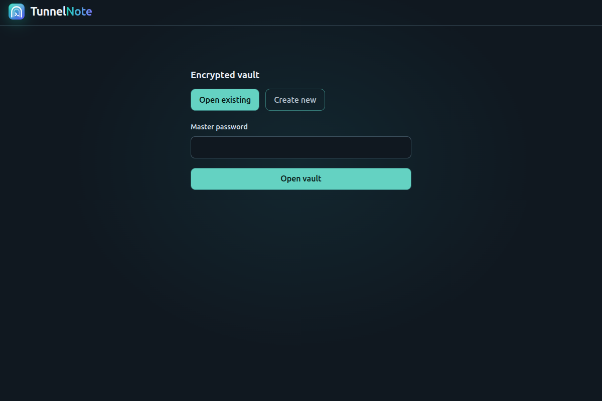
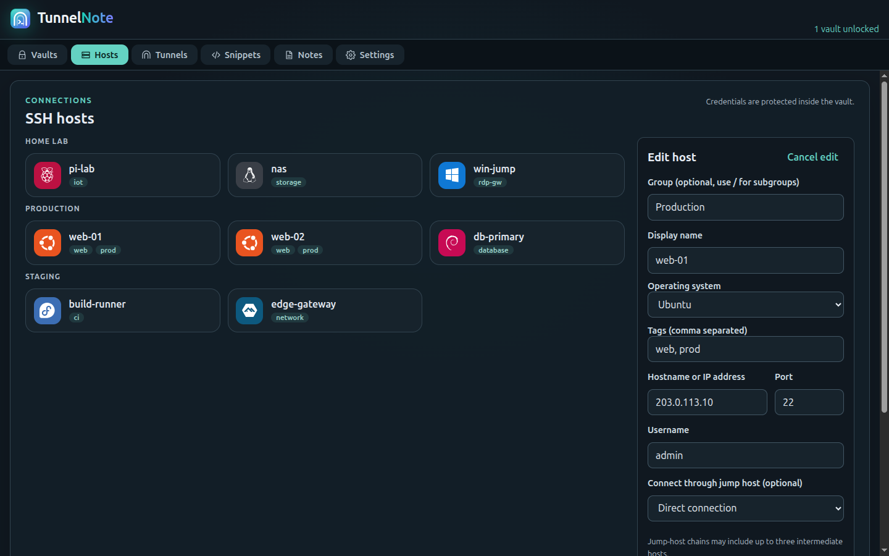
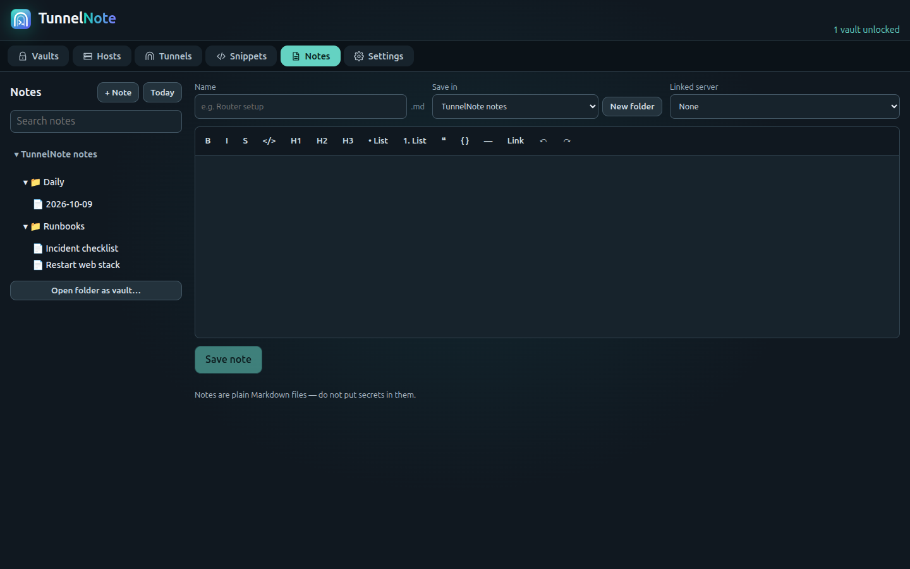

<div align="center">

# TunnelNote

**A free, open-source, local-first SSH workspace — terminals, SFTP, tunnels and runbook notes in one encrypted, cross-platform app.**

[](https://github.com/iven86/tunnelnote/actions/workflows/ci.yml)
[](./LICENSE)


[Download](https://github.com/iven86/tunnelnote/releases/latest) · [Security](./SECURITY.md) · [Contributing](./CONTRIBUTING.md)

</div>

## Why TunnelNote

Your servers, credentials and operational knowledge shouldn't live in someone else's cloud. TunnelNote keeps everything **on your machine**, in a KeePass-compatible (KDBX) vault protected by Argon2id, with no account, no telemetry and no subscription.

- **Free forever, MIT licensed** — for individuals and teams.
- **Local-first** — no sync service, no sign-up, no data leaves your device.
- **One app, three platforms** — Windows, macOS and Linux installers from every release.

## Screenshots

Screenshots use demo data only.

| Unlock | Hosts and groups |
| --- | --- |
|  |  |



## Download

Grab the build for your system from the **[latest release](https://github.com/iven86/tunnelnote/releases/latest)**:

| System                 | File                                         |
| ---------------------- | -------------------------------------------- |
| Windows 10/11 (64-bit) | `TunnelNote-<version>-windows-x64-setup.exe` |
| macOS, Apple Silicon   | `TunnelNote-<version>-macos-arm64.dmg`       |
| macOS, Intel           | `TunnelNote-<version>-macos-x64.dmg`         |
| Linux (any distro)     | `TunnelNote-<version>-linux-x86_64.AppImage` |
| Debian / Ubuntu        | `TunnelNote-<version>-linux-amd64.deb`       |

Each release includes `SHA256SUMS.txt`. Builds are **not code-signed yet**: Windows SmartScreen and macOS Gatekeeper may warn on first launch (on macOS, right-click → Open). Linux AppImage: `chmod +x` and run.

## Features

- **Multiple vaults at once** — open several KDBX vaults side by side (e.g. personal and work), lock or close each independently; your vault list and default are remembered between launches.
- **Settings** — choose where data is stored, auto-lock timing, terminal options, and optional per-session or single-file SSH session logs.
- **Encrypted vault** — KDBX with Argon2id, password-only unlock, host address stored in the standard URL field, per-host notes in the standard Notes field, and vault groups, so the file stays readable in other KDBX-compatible tools; atomic saves with backups, auto-lock on idle/minimize.
- **SSH terminal** — tabbed sessions, split view, jump hosts, keepalive, password / key / agent / keyboard-interactive auth, strict host-key verification.
- **SFTP** — browse, upload, download and manage remote files with progress.
- **Tunnels** — local, remote and dynamic (SOCKS5) forwarding; public binds require explicit confirmation.
- **Snippets & multi-host runner** — parameterised, shell-safe commands across connected sessions, exportable results.
- **Notes & runbooks** — a rich-text editor (bold, headings, lists, code, links) that saves plain Markdown; a folder-tree sidebar, open any folder on disk as a notes vault (remembered), create folders, daily notes, clickable `[[wikilinks]]` (missing targets are created on click), backlinks, link a note to a server (name, address, tags), search and secret-leak warnings. Notes are plain Markdown files, so they also open in other Markdown editors.

## Security model

The renderer is sandboxed with no Node.js access; all privileged work happens in the main process behind a narrow, schema-validated bridge. Secrets stay in the encrypted vault. See [SECURITY.md](./SECURITY.md).

## Build from source

Requires Node.js 22 and npm.

```sh
npm ci
npm run dev           # Windows / macOS
npm run dev:linux     # Linux dev mode (hot reload; starts a local Vite dev server on :5173)
npm run start:linux   # Linux: build and run with no dev server

npm run lint && npm run typecheck && npm test
npm run build         # compile
npm run package       # installers for the current OS → release/
```

More commands: [COMMANDS_AND_BUILD_GUIDE.md](./COMMANDS_AND_BUILD_GUIDE.md). Releases are produced by GitHub Actions: every push to `main` builds installers for Windows, macOS and Linux and publishes them as a new versioned release (`major.minor` from `package.json` plus the run number). Pushing a tag such as `v1.0.0` publishes that exact version.

## Testing status — honest summary

**Tested**

- 49 automated unit/integration tests (vault, SSH session logic, SFTP, forwarding with a simulated client, SOCKS5 parsing, snippet quoting, notes folders/locations/front matter, session-log transcripts).
- Lint, strict typecheck and production build.
- Manual runs on **Linux**: vault create/unlock, SSH connection to a real server, SFTP browsing, the UI of every tool tab, and launching a packaged Linux build.

**Not yet tested**

- Running the app and installers on **Windows and macOS** (CI builds and unit-tests them; hands-on testing is pending).
- Tunnels and the multi-host runner against a real SSH server (only simulated so far).
- Long-running session stability and code-signed/notarized installers.

**Not supported yet:** local terminal, serial and Mosh.

## Project layout

`src/main` privileged process · `src/preload` bridge · `src/renderer` React UI · `src/shared` schemas · `tests` · `docs`.

## License

[MIT](./LICENSE). Third-party notices: [THIRD_PARTY_LICENSES.md](./THIRD_PARTY_LICENSES.md).
